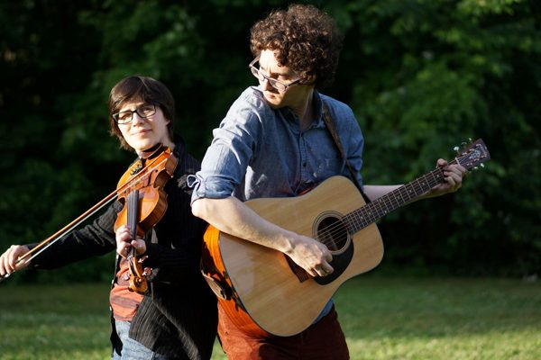
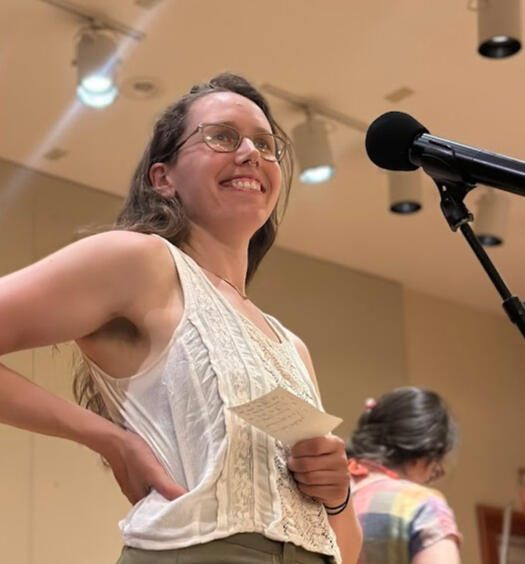
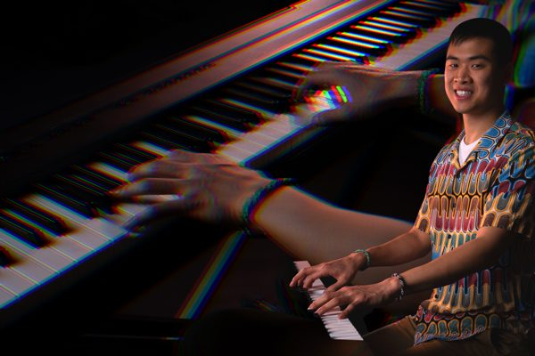
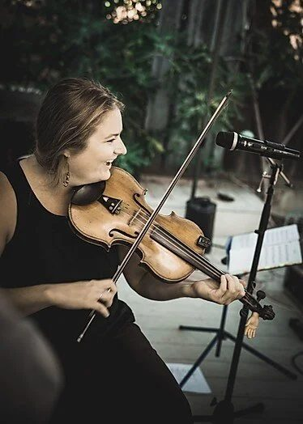

**October 2–4, 2026** at Hulbert Outdoor Center in Fairlee, VT (2968 Lake Morey Rd, Fairlee, VT 05045).

## Schedule

The original schedule is also available as a PDF: [YDW Schedule 2026](/documents/schedule-2026.pdf)

### FRIDAY

* 4:00–6:00 PM: Arrival and Check-In *(Front porch)*
* 4:30–5:30 PM: Staff Sound Check — ECD 4:30–5:00, Contra 5:00–5:30
* 6:00–7:00 PM: Dinner *(Dining Hall)*
* 7:30–9:00 PM: Contra with Hannah and Cojiro *(Dance Barn)*
* 9:00–9:30 PM: Announcements
* 9:30–11:00 PM: English with Harris and Jacob & Audrey *(Dance Barn)*
* 11:00–11:30 PM: Snack! *(Dining Hall)*
* 11:30 PM–12:45 AM: LATE NIGHT WALTZING! *(Upper Dining Hall)*

### SATURDAY

* 8:00–9:00 AM: Breakfast *(Dining Hall)*
* 9:15–10:15 AM: Scottish Country Dancing with Kat Dutton and Clara and Rose *(Dance Barn)*
* 10:30–11:45 AM: ContraLab with Hannah and Cojiro *(Dance Barn)*
* 12:00–1:00 PM: Lunch *(Dining Hall)*
* 1:30–2:30 PM: Camper-led Activities
  * Line Dancing *(Upper Dining Hall)*
  * Sea Shanty Sing *(Pirate Ship)*
* 2:45–4:00 PM: Day Rave Techno Contra! with Blue Joy *(Dance Barn)*
* 4:15–5:30 PM: Community Conversation
* 6:00–7:00 PM: Dinner *(Dining Hall)*
* 7:30–9:00 PM: English with Harris and Jacob & Audrey *(Dance Barn)*
* 9:00–9:30 PM: Charts and Graphs
* 9:30–11:00 PM: Contra with Hannah and Cojiro *(Dance Barn)*
* 11:00–11:30 PM: Snack!
* 11:30 PM onward:
  * Fusion Dancing *(Upper Dining Hall)*
  * Pub Sing *(Dance Barn balcony)*
  * Instrumental Jam *(The Cave)*

### SUNDAY

* 8:00–9:00 AM: Breakfast *(Dining Hall)*
* 9:00–10:15 AM: ECD with Harris and Jacob & Audrey *(Dance Barn)*
* 10:30 AM–12:00 PM: Camper-led Contra *(Dance Barn)*
* 12:00–12:45 PM: Lunch *(Dining Hall)*
* 12:45 PM: Group photo
* 1:15–3:00 PM: Farewell Dance with all staff *(Dance Barn)*
* 3:00 PM: Eat the leftover snacks!
* DEPARTURES — by 4:00 PM!

## Talent

### [Cojiro](https://cojiroduo.bandcamp.com/) — Contra band

Jess Newman (fiddle) and Mark Price (guitar).

*(Photo from [Cojiro's Bandcamp page](https://cojiroduo.bandcamp.com/))*

### [Hannah Chamberlain](https://hannahchamb.com/) — Calling contras

*(Photo from [Hannah Chamberlain's website](https://hannahchamb.com/))*

### Jacob & Audrey — English country dance band

[Jacob Chen](https://www.jacobchenmusic.com/) and [Audrey Jaber](http://audreyleighjaber.com/).

*(Jacob Chen — photo from [Jacob Chen's website](https://www.jacobchenmusic.com/))*

*(Audrey Jaber — photo from [Audrey Jaber's website](http://audreyleighjaber.com/))*

### [Harris Lapiroff](https://chromamine.com/dance/) — Calling English

### Kat Dutton — Teaching Scottish Country Dance

### Blue Joy — Techno contra

Steven Bluestein and Abe Joyner-Meyers.

## Photos

[Google Photos album](https://photos.app.goo.gl/pkwpHpBQ3Vd73msC7)

## Venue

* [Hulbert facility map](/documents/hulbert-facility-map.pdf)
* [Hulbert main house map](/documents/hulbert-main-house.pdf)
